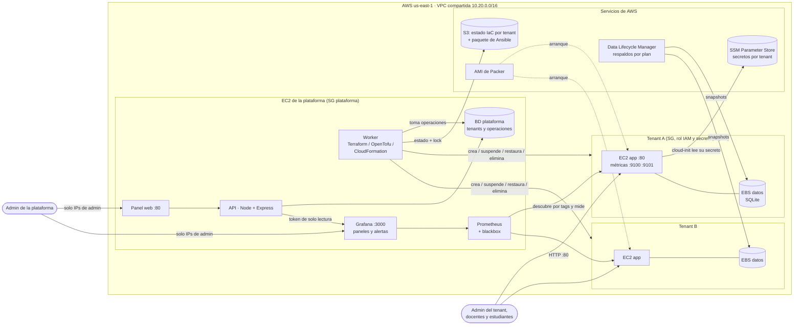
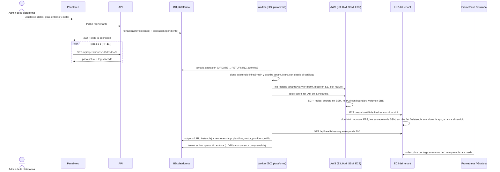
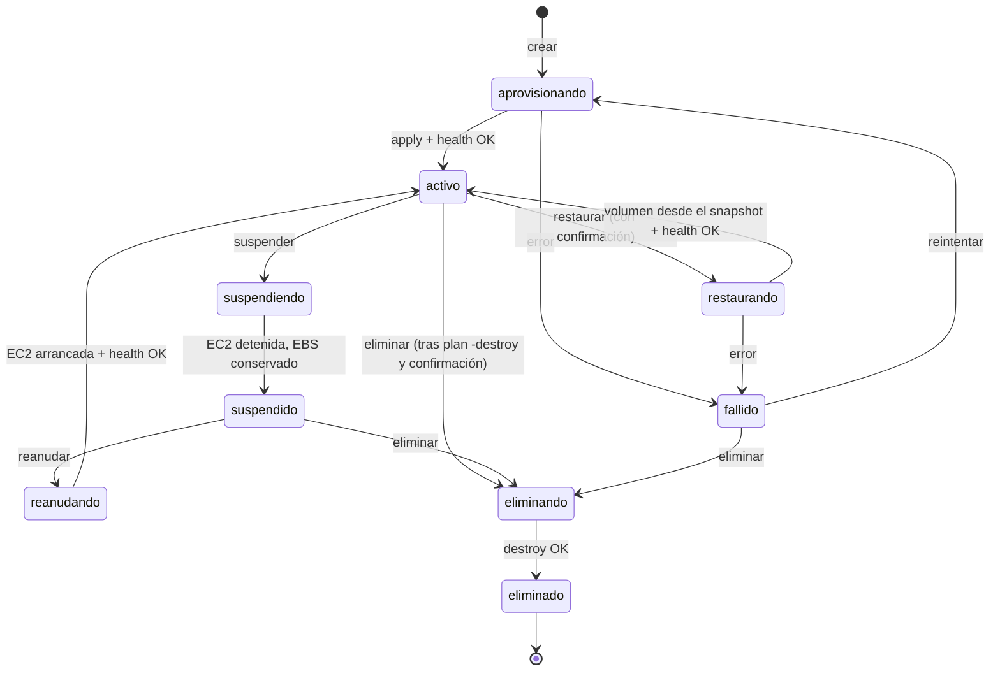

# Arquitectura: plataforma de tenants de Asistencia

Entregable 3: diagrama de arquitectura y flujo de creación de un tenant. Los diagramas están en Mermaid y GitHub los muestra directamente.

## 1. Vista general

Hay dos planos:

- **Plano de control (la plataforma):** una EC2 `t3.small` con IP elástica (`infra/plataforma`). Aloja el panel web, la API, el worker que ejecuta los motores de IaC, la base de datos de la plataforma (SQLite), Prometheus, blackbox_exporter y Grafana. La configura Ansible.
- **Plano de datos (los tenants):** cada institución tiene su propia EC2 (frontend y backend de la app), su propio volumen EBS de datos (SQLite), su propio Security Group, su propio rol IAM y sus propios secretos en SSM. Ningún tenant comparte cómputo, disco ni credenciales con otro.

**Red:** todos los tenants comparten una VPC con dos subredes públicas (`infra/red`) en lugar de tener una VPC cada uno, porque AWS limita a 5 VPC por región. El aislamiento lo dan los Security Groups: el de un tenant solo acepta el puerto 80 desde internet, y los puertos 9100, 9101 y 22 solo desde el SG de la plataforma. Ningún SG de tenant referencia a otro (ver [aislamiento.md](aislamiento.md)).

## 2. Flujo de creación de un tenant

Si el `apply` falla, la operación queda `fallida` con un mensaje comprensible ([worker/errores.js](../worker/errores.js)). **Reintentar** (RF-12) vuelve a ejecutar `apply` sobre **el mismo estado** en S3: el motor compara el estado con lo que existe en AWS y solo crea lo que falta. Se comprobó dos veces con fallos reales (un permiso IAM que faltaba y un tipo de instancia que no admite el plan gratuito de AWS).

## 3. Ciclo de vida del tenant

El respaldo a pedido no cambia el estado del tenant. Todas las operaciones quedan en el historial con quién la pidió, cuándo, el resultado, el log y las versiones usadas (vista *Auditoría*).

## 4. Función de cada herramienta

| Herramienta | Qué hace en esta arquitectura |
|---|---|
| **Terraform** | Motor principal. El módulo `tenant` de `asistencia-infra` crea todo lo de un tenant: SG, secreto en SSM, rol IAM, volumen EBS y EC2. Cada tenant tiene su propio estado en S3. También crea la plataforma: `infra/bootstrap` (bucket del estado), `infra/red` (VPC compartida) e `infra/plataforma` (EC2, IAM, respaldos). |
| **OpenTofu** | El mismo HCL que Terraform; el worker solo cambia el binario (`tofu`). Se probó creando un tenant con OpenTofu 1.13.9, que usa los providers de `registry.opentofu.org` y el mismo bucket de estado. |
| **CloudFormation** | Segunda implementación reducida ([asistencia-infra/cloudformation/tenant.yaml](../../asistencia-infra/cloudformation/tenant.yaml)), un stack `asistencia-<id>` por tenant: mismo SG, rol IAM con boundary, volumen y EC2, con el mismo cloud-init. Permite crear, suspender, reanudar, eliminar con previsualización y reintentar; restaurar queda solo para Terraform/OpenTofu. Lo que CloudFormation no hace (el secreto SecureString, el estado de la instancia) lo resuelve el motor del worker ([worker/motores/cloudformation.js](../worker/motores/cloudformation.js)). |
| **Pulumi** | No está integrado: se cubre con la comparación técnica de la sección 6. |
| **Packer** | Construye la AMI de los tenants (`asistencia-tenant-<fecha>`, tag `Rol=ami-tenant`): Amazon Linux 2023, Node.js, node_exporter y la caché de npm de la app. No tiene datos ni secretos. Con ella un tenant arranca en unos 2 minutos. |
| **cloud-init** | Primer arranque de cada EC2 de tenant: monta el volumen de datos (lo formatea solo si está vacío), lee el secreto del tenant desde SSM con el rol de la instancia, escribe la configuración de la app (incluido el nombre de la institución), clona la app en la versión pedida y arranca el servicio. También prepara la EC2 de la plataforma para ejecutar Ansible. |
| **Ansible** | Configuración posterior de la **EC2 de la plataforma**: Prometheus, blackbox_exporter, Grafana (datasource, dashboard y alertas como código), y el portal, la API y el worker (Node, Terraform, OpenTofu, servicios systemd). Terraform sube el playbook a S3; una asociación de SSM lo vuelve a aplicar cuando cambia, sin SSH y sin recrear la instancia. Los tenants no usan Ansible: son inmutables y se recrean desde la AMI y cloud-init. |
| **Prometheus + Grafana** | Prometheus descubre las EC2 de los tenants por tags (`Tenant`, `Entorno`, `Plan`) y las mide con un intervalo según el plan. Grafana muestra el dashboard por tenant y entorno y evalúa 7 reglas de alerta. La plataforma lee las alertas por la API de Grafana con un token de solo lectura (RF-29). |
| **AWS Data Lifecycle Manager** | Respaldos programados: una política por plan respalda el volumen de datos de cada tenant con la frecuencia y la retención del catálogo. |

## 5. Decisiones y requisitos no funcionales

- **Aislamiento:** cada tenant tiene su EC2, su volumen, su SG, su rol IAM y sus secretos. El rol solo puede leer los parámetros de su tenant, y lo garantiza un *permissions boundary* basado en el tag `Tenant` del rol. Evidencias en [aislamiento.md](aislamiento.md).
- **Secretos:** nunca están en el código ni en los repositorios. Terraform los genera y los guarda en SSM (SecureString). La instancia los lee con su rol, y el log de cada operación se sanea antes de guardarse ([comun/sanitizar.js](../comun/sanitizar.js)).
- **Credenciales del worker:** en la EC2 usa el rol IAM de la instancia, sin claves. Solo puede modificar recursos con el tag `Componente=tenant` y no puede tocar la plataforma ([infra/README.md](../infra/README.md#permisos-del-worker)).
- **Estado del motor:** en S3, cifrado, versionado, sin acceso público y con lock nativo (`use_lockfile`). Hay una clave por tenant ([infra/README.md](../infra/README.md#cómo-se-guarda-y-protege-el-estado)).
- **Trabajos en segundo plano:** la API solo registra la operación y responde `202`. El worker toma una operación a la vez, de forma atómica, y un candado impide que corran dos workers.
- **Operaciones repetibles:** todas son un `apply` idempotente sobre el mismo estado; reintentar no duplica recursos.
- **Suspensión:** se detiene la EC2 y se conserva el volumen de datos, así que solo se pagan los discos. La retención por plan está en [planes.md](planes.md).
- **Base de datos:** SQLite en un volumen EBS cifrado por tenant, montado en `/var/lib/asistencia`. La app no cambia (RF-21) y el plan define el tamaño del volumen.
- **Respaldos:** snapshots del volumen de datos, programados con DLM o a pedido. Restaurar reemplaza el volumen, después de un respaldo de seguridad ([respaldos.md](respaldos.md)).
- **Costos:** cada tenant se puede suspender o eliminar desde el panel; la guía de operación explica cómo apagar todo ([operacion.md](operacion.md#costos-y-apagado)).

## 6. Comparación técnica de los motores

El enunciado pide, para Pulumi y CloudFormation, "segunda implementación pequeña o comparación técnica con el motor principal". CloudFormation tiene la implementación reducida; esta comparación cubre los tres, con lo que se observó al implementar CloudFormation:

| Criterio | Terraform / OpenTofu (implementado) | Pulumi | CloudFormation |
|---|---|---|---|
| Lenguaje | HCL declarativo | TypeScript, Python, Go… (lenguajes generales) | YAML o JSON declarativo |
| Estado | Archivo en S3 por tenant, con lock nativo de S3 | Backend propio (Pulumi Cloud) o S3 (`pulumi login s3://`), un stack por tenant | Lo guarda AWS (un stack por tenant); no hay archivo que proteger |
| Reintento sin duplicar (RF-12) | `apply` sobre el mismo estado | `pulumi up` sobre el mismo stack | Si la creación falla, el stack queda en `ROLLBACK_COMPLETE` (ya sin recursos) y no admite cambios: el motor lo borra y lo vuelve a crear |
| Previsualizar la eliminación (RF-18) | `plan -destroy`, legible y en JSON | `pulumi preview --destroy` | No tiene vista previa del borrado: el motor lista los recursos del stack (`list-stack-resources`) |
| Secretos generados | `random_password` + `aws_ssm_parameter` SecureString | Provider `random` + SSM | `AWS::SSM::Parameter` no admite SecureString: el motor crea el secreto fuera del stack |
| Suspender (detener la EC2) | `aws_ec2_instance_state` | Recurso de estado del provider | No hay recurso: el motor usa `stop-instances` / `start-instances`, fuera del stack |
| Datos que dependen de otro recurso (id del volumen en el user data) | `templatefile` con el id del recurso | Se interpolan *outputs* | El worker genera el user data antes de que exista el volumen: cloud-init lo busca por su nombre de dispositivo (`/dev/sdf`) |
| Multi-nube | Sí (providers) | Sí | Solo AWS |
| Secretos | Variables `sensitive`; el valor queda en el estado, que por eso se trata como secreto | Cifra los secretos dentro del estado | Parámetros `NoEcho` y referencias dinámicas a SSM |
| Ajuste a esta plataforma | El worker ya lo usa; el mismo HCL sirve para dos motores | Sumaría Node/npm y el CLI de Pulumi al worker | Solo necesita el AWS CLI, pero el borrado y los reintentos son más rígidos |

Por eso **Terraform es el motor principal**, **OpenTofu** el segundo (con las mismas plantillas, el mismo estado y el mismo comportamiento) y **CloudFormation** la implementación reducida. En el asistente se pueden elegir los tres; Pulumi aparece como "próximamente".
