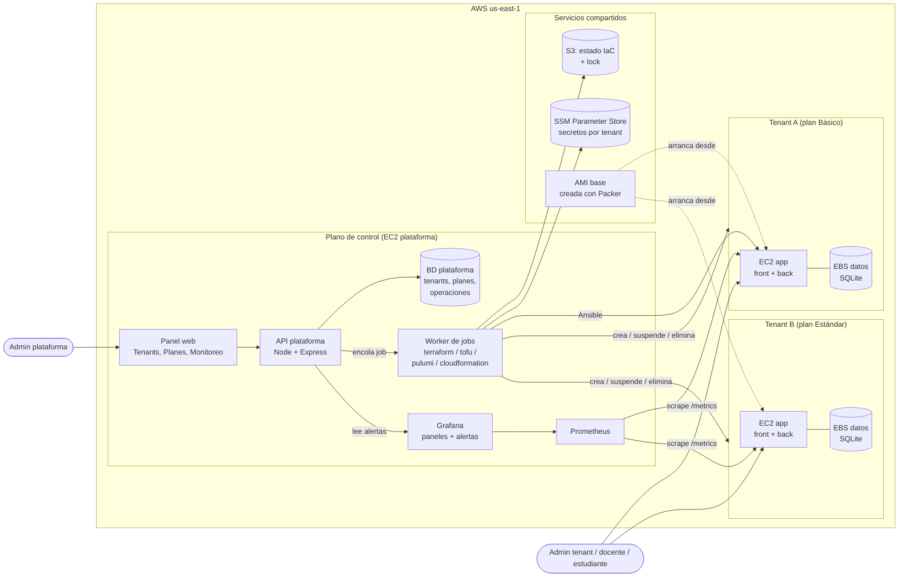
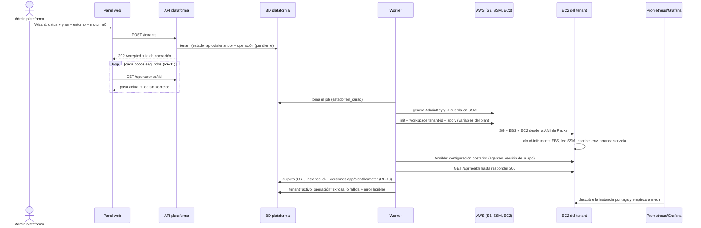
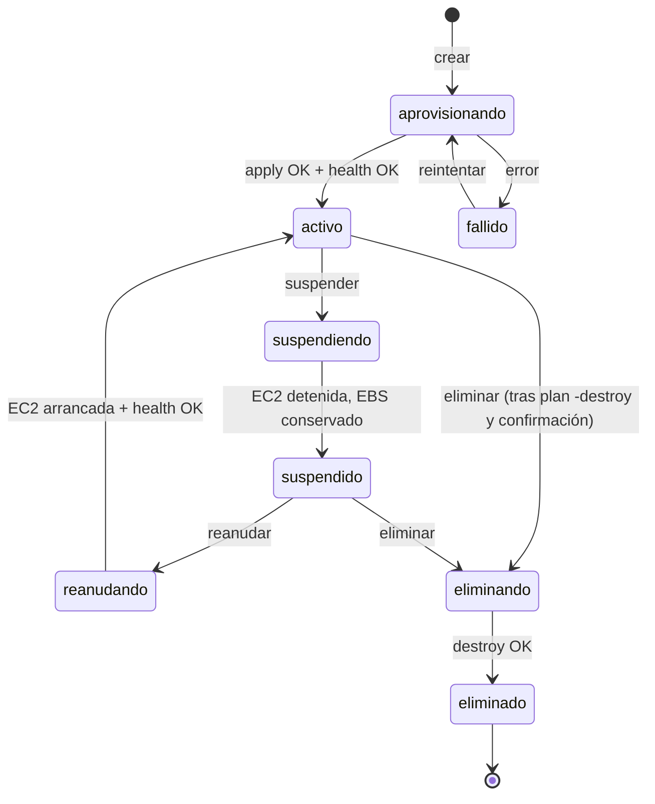

# Arquitectura: plataforma de tenants de Asistencia

Borrador del entregable 3 ("Diagrama de arquitectura y flujo de creación de un tenant").
Los diagramas están en Mermaid y GitHub los muestra directamente.

## 1. Vista general

Hay dos planos:

- **Plano de control (la plataforma):** una sola instancia. Aloja el panel de administración, la API, el worker que ejecuta los motores de IaC, la base de datos de la plataforma, Prometheus y Grafana.
- **Plano de datos (los tenants):** cada institución tiene su propia EC2 (frontend + backend), su propio volumen de datos y su propio Security Group. Ningún tenant comparte cómputo ni base de datos con otro.

## 2. Flujo de creación de un tenant

Si el apply falla, la operación queda `fallida` con el error. Reintentar (RF-12) vuelve a correr `apply` sobre **el mismo workspace o stack**. El motor compara el estado guardado con lo que existe en AWS y solo crea lo que falta, así que no duplica recursos.

## 3. Ciclo de vida del tenant

## 4. Función de cada herramienta

| Herramienta | Qué hace en esta arquitectura |
|---|---|
| **Terraform / OpenTofu** | Motor principal. Un mismo módulo `tenant` (SG, EBS, EC2) con un workspace por tenant y el estado en S3. OpenTofu usa el mismo HCL; solo cambia el binario que llama el worker (RF-08). También crea el plano de control. |
| **Pulumi** | Segunda implementación reducida del stack de un tenant (un stack de Pulumi por tenant), para comparar con Terraform. |
| **CloudFormation** | Segunda implementación reducida: un stack por tenant (`asistencia-<tenant>`), a partir de las plantillas que ya existen. |
| **Packer** | Construye la AMI base: Amazon Linux 2023, Node, la app en una versión fija, node_exporter y la unidad systemd. Así el arranque es rápido y repetible. |
| **cloud-init** | Configuración del primer arranque de cada tenant: monta el volumen de datos, lee los secretos del tenant desde SSM, escribe `.env` y arranca el servicio. |
| **Ansible** | Configuración posterior: aplica cambios a VMs que ya existen (versión de la app, agentes, ajustes del plan) sin recrearlas. |
| **Prometheus + Grafana** | Prometheus descubre las EC2 por tags (`Tenant`, `Entorno`, `Plan`) y mide CPU, memoria, disponibilidad y métricas de la app. Grafana muestra los paneles por tenant y entorno y dispara las alertas; la plataforma las consulta por la API de Grafana (RF-29). |

## 5. Decisiones y requisitos no funcionales

- **Aislamiento:** cada tenant tiene su propia EC2, su propio volumen de datos y su propio Security Group. El SG solo permite HTTP desde internet y los puertos de métricas desde el SG de la plataforma; no hay tráfico entre tenants.
- **Red compartida:** todos los tenants usan una sola VPC con subred pública, en vez de una VPC por tenant. AWS limita a 5 VPC por región por defecto, y el aislamiento se logra con los Security Groups.
- **Secretos:** se guardan en SSM Parameter Store (SecureString) bajo `/asistencia/<tenant>/...`. No van en tfvars, en el repo ni en los logs; el worker filtra los valores sensibles antes de guardar la salida del motor.
- **Estado del motor:** se guarda en un bucket S3 con cifrado y versionado, bloqueo de acceso público y lock nativo de S3. Cada tenant usa la clave `tenants/<id>/terraform.tfstate`, y el acceso está restringido al rol IAM del worker.
- **Trabajos en segundo plano:** la API solo encola trabajos. El worker los ejecuta de uno en uno por tenant y guarda el historial de cada operación (quién, cuándo, resultado y log).
- **Suspensión:** se detiene la EC2 y se conserva el EBS de datos; solo se paga el disco. Los datos se mantienen según la política de retención del plan.
- **Costos:** la plataforma puede destruir todos los tenants de prueba con una operación; para la demo se usan t3.micro.

- **Base de datos (decidido):** SQLite en un volumen EBS dedicado a cada tenant, cifrado y montado en `/var/lib/asistencia`. La app no cambia (RF-21) y el plan define el tamaño del volumen.
- **Alcance de la demo (decidido):** de 3 a 4 tenants. La cuota de la cuenta es de 16 vCPU On-Demand: con instancias t3.micro/small (2 vCPU cada una), 4 tenants y la plataforma suman 10 vCPU.

Detalle de cómo se protege el estado: [infra/README.md](../infra/README.md).

## 6. Fase final

- Respaldar y restaurar (RF-19, entregable 6) con snapshots del volumen de datos de cada tenant, según la política de cada plan en [planes.md](planes.md).
