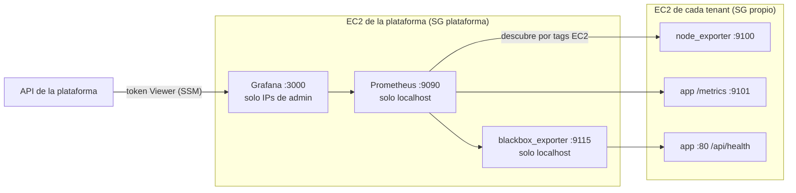

# Monitoreo y alertas (RF-25 a RF-29)

Prometheus mide, Grafana muestra los paneles y evalúa las alertas, y el panel de la plataforma lee esas alertas por la API de Grafana. Todo corre en la EC2 de la plataforma (`infra/plataforma`) y lo instala Ansible (`ansible/`).



## Qué se mide

| Origen | Métricas | Para qué |
|---|---|---|
| **node_exporter** (en la AMI de Packer) | CPU, memoria, disco del volumen de datos `/var/lib/asistencia`, estado de `asistencia.service` | Recursos de la instancia |
| **App** (`prom-client`, puerto 9101) | `http_requests_total{codigo}`, `http_request_duration_seconds`, `asistencia_db_up`, `asistencia_estudiantes`, `asistencia_limite{recurso}` | Tráfico, errores 5xx, latencia, base de datos y uso del plan (RF-26) |
| **blackbox_exporter** | `probe_success`, `probe_duration_seconds` sobre `/api/health` | Disponibilidad vista desde fuera de la instancia |

**Descubrimiento:** Prometheus no tiene una lista de tenants. Usa `ec2_sd_configs` con los filtros `Proyecto=asistencia`, `Componente=tenant` e `instance-state-name=running`, y copia los tags `Tenant`, `Entorno` y `Plan` como etiquetas `tenant`, `entorno` y `plan` (RF-25). Un tenant nuevo aparece solo en un minuto, y uno suspendido deja de medirse, así que no genera alertas.

**Intervalo por plan:** hay un trabajo por plan con el `intervalo_metricas_s` del catálogo (Básico 60 s, Estándar 30 s, Avanzado 15 s). La etiqueta `job` se normaliza a `node`, `app` y `disponibilidad`.

**Aislamiento:** los puertos 9100 y 9101 de un tenant solo aceptan tráfico del SG de la plataforma. Comprobado: desde internet no responden.

## Panel de Grafana

Dashboard `Tenants del Sistema de Asistencia` (uid `asistencia-tenants`, carpeta *Asistencia*), con filtros por **entorno, plan y tenant** (RF-27):

- Estado: disponibilidad de cada tenant y uso del límite de estudiantes del plan.
- Recursos: CPU, memoria y disco de datos.
- Aplicación: peticiones por segundo, errores 5xx por minuto, latencia p95, tiempo de respuesta de `/api/health` y estado de la base de datos.

Los paneles de **Estado** usan consultas instantáneas: solo muestran los tenants que se midieron en los últimos 5 minutos. Un tenant suspendido o eliminado desaparece de ellos, pero sigue en las gráficas de tiempo (y en el filtro *Tenant*) mientras su historial esté dentro del rango elegido.

El dashboard es código (`ansible/roles/grafana/files/tenants.json`) y no se puede editar desde la interfaz: los cambios se hacen en el repo y se aplican con Ansible.

## Alertas (RF-28)

Los umbrales salen de `comunes.alertas` en `catalogo/planes.json`; Terraform los pasa a Ansible en `vars.json`.

| Regla | Condición | Severidad |
|---|---|---|
| Servicio caído | `probe_success < 1` durante `servicio_caido_min` (2 min) | Crítica |
| Base de datos sin respuesta | `asistencia_db_up < 1` durante 2 min | Crítica |
| Errores 5xx | más de `errores_5xx_por_min` (5) por minuto | Alta |
| Disco de datos casi lleno | más de `disco_datos_porcentaje` (80 %) durante 5 min | Alta |
| CPU alta | más de `cpu_porcentaje` (85 %) durante 5 min | Media |
| Memoria alta | más de `memoria_porcentaje` (90 %) durante 5 min | Media |
| Cerca del límite de estudiantes | más de `estudiantes_porcentaje_limite` (90 %) del plan | Baja |

Cada regla dispara una alerta por tenant, con sus etiquetas `tenant`, `entorno` y `plan`. Si no hay datos, el estado es OK: así un tenant suspendido o recién creado no genera alertas falsas.

**Prueba realizada:** se detuvo la app de `colegio-andino`. La alerta *Servicio caído* pasó a "en observación" a los 26 s y a "disparada" a los 2 min. Al volver a arrancar la app, se resolvió en unos 30 s.

## Alertas en la plataforma (RF-29)

`GET /api/monitoreo` (y `?tenant=<id>`) consulta `/api/prometheus/grafana/api/v1/rules` de Grafana y devuelve cada regla con su estado y las alertas activas por tenant. El panel las muestra en:

- **Monitoreo:** contadores, la tabla de alertas activas y el estado de cada regla. Se actualiza cada 30 s.
- **Detalle del tenant:** sus alertas y un enlace a su panel en Grafana (`?var-tenant=<id>`).

La API usa una **cuenta de servicio de Grafana con rol Viewer**. Ansible crea su token y lo guarda en SSM (`/asistencia/plataforma/grafana-token`, SecureString); la API lo lee de ahí y nunca lo envía al navegador. Con ese token, los endpoints de administración de Grafana devuelven 403.

Grafana no tiene configurado un canal de notificación (correo, Slack…): las alertas se consultan en el panel de la plataforma y en Grafana.

## Acceso

- **Grafana:** `terraform output grafana_url` en `infra/plataforma`. Usuario `admin`; la contraseña está en SSM:

  ```bash
  aws ssm get-parameter --with-decryption --name /asistencia/plataforma/grafana-admin --query Parameter.Value --output text
  ```

  Solo se abre desde las IPs de `cidrs_admin`. Si cambia tu IP, actualiza `terraform.tfvars` y vuelve a aplicar.
- **Prometheus:** escucha solo en localhost. Para verlo, usa un túnel de Session Manager:

  ```bash
  aws ssm start-session --target <instance_id> --document-name AWS-StartPortForwardingSession --parameters portNumber=9090,localPortNumber=9090
  ```
